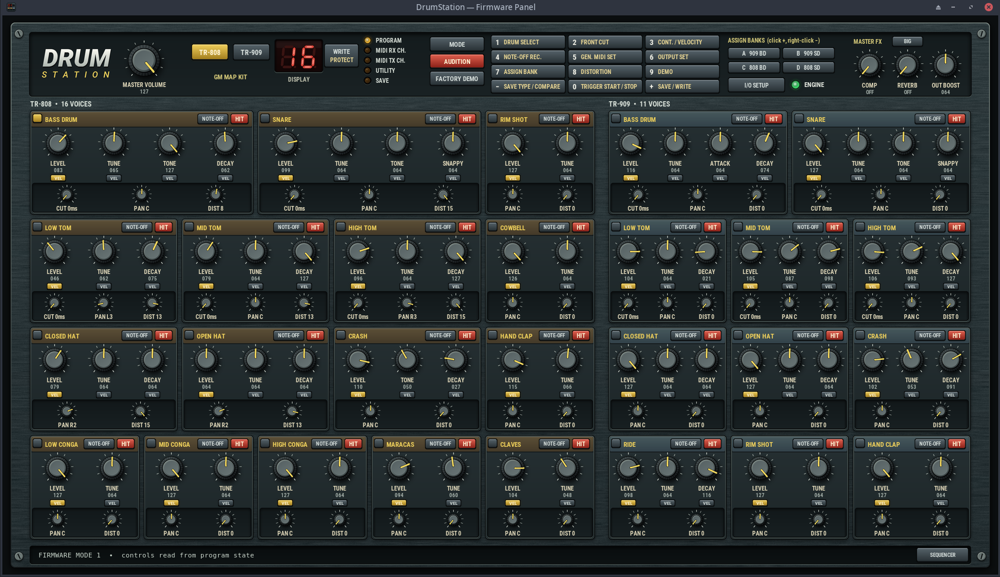
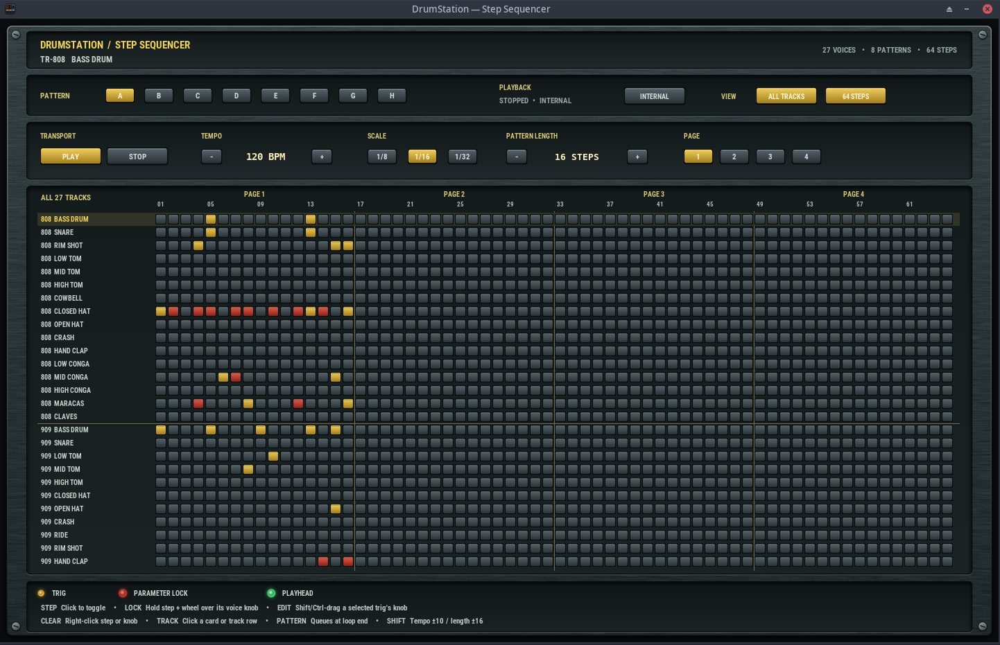

# DrumStation Emulator

A desktop emulator for the Novation DrumStation. It runs the original v1.2 controller and DSP firmware to produce audio from MIDI. The Linux Tk panel exposes both TR-808 and TR-909 voices, and a separate step sequencer provides 27 tracks, eight patterns, up to 64 steps, parameter locks, and internal or external MIDI clock. A JUCE VST3 and standalone build is also available with a basic status editor.

**Firmware is not included.** You must supply your own legally obtained `v1.2.u15` and `v1.2.u28` ROM images. The import tool checks their sizes and SHA-1 hashes. This project is unaffiliated with Novation.





## Download

Get the [Linux x86_64 release archive](https://github.com/amorgan101010/drumstation-emulator/releases/latest). It includes the built engine, GUI, and artwork. Extract it, add your own ROMs as described in its `README.txt`, then run `python3 tools/gui.py` from the extracted folder.

## Requirements

Linux, a C++20 compiler, CMake 3.20 or newer, ALSA development headers/library, Python 3 with Tkinter, and an ALSA audio device. The panel and sequencer artwork is included in `tools/assets/`.

On Debian or Ubuntu, the relevant packages are `build-essential cmake libasound2-dev python3 python3-tk`.

## Build and run

```sh
python3 tools/roms.py --import-zip /path/to/your/drumsta.zip
cmake -S . -B build -DCMAKE_BUILD_TYPE=Release
cmake --build build -j 3
python3 tools/gui.py
```

The ZIP must contain `v1.2.u15` and `v1.2.u28` at its top level. The imported images go into the ignored `roms/` directory. You can instead place those two files there and run `python3 tools/roms.py` to verify them. Run `ctest --test-dir build --output-on-failure` for tests; firmware dependent tests need the ROMs.

The panel starts the realtime engine. **I/O SETUP** selects the audio device, MIDI input, and channel. It creates an ALSA sequencer port named **DrumStation MIDI In** for DAW routing. Click **SEQUENCER** at the bottom of the panel to open the step sequencer. The panel saves settings under `$XDG_CONFIG_HOME/drumstation/` and its emulated EEPROM under `$XDG_DATA_HOME/drumstation/`, or the corresponding `~/.config` and `~/.local/share` directories.

### JUCE VST3 and standalone

The GitHub Actions build workflow produces VST3 and JUCE standalone artifacts for Linux, macOS, and Windows. To build locally, check out JUCE 8.0.8 beside this repository and run `cmake -S . -B build-juce -DDRUMSTATION_PLUGIN=ON -DJUCE_DIR=../JUCE`, followed by `cmake --build build-juce --config Release`. The plugin looks for `v1.2.u15` and `v1.2.u28` in `DRUMSTATION_ROM_DIR` when set, otherwise in the operating system's application data directory under `DrumStation/roms`. The ROM files are never included in build artifacts. The JUCE editor currently shows ROM status; the full panel and sequencer are available in the Linux Tk application.

You can also use the command line:

```sh
build/drumstation --realtime --audio default --midi seq --channel 15
python3 tools/render.py --notes 36,38,42,46,49 --out build/drums.wav
python3 tools/render.py --factory-demo --out build/factory-demo.wav
build/drumstation --help
```

The renderer writes a WAV and diagnostic files. `tools/factory_demo.py` can export the ROM's drum demo as a MIDI file.

## Current scope

The emulator executes the original controller and DSP code, with a standalone Panasonic MN1880 family core and a MAME derived ADSP-2181 core. The panel has per-voice controls, firmware program recall and saving, a factory demo control, output boost, compressor, and two reverb modes. The sequencer supports note steps, velocity, parameter locks, and MIDI clock transport.

This remains an experimental emulator. Peripheral and timing behavior is incomplete, the sample clock is provisional, individual hardware outputs are not modeled, and some panel controls use a temporary firmware MIDI path while the physical ADC scan is still being mapped. It is not a validated cycle accurate or sonically identical replacement for the hardware. The realtime audio path is Linux/ALSA specific.

## License and provenance

The project's own code is GPL-3.0-or-later; see [LICENSE](LICENSE). Vendored processor cores retain BSD-3-Clause notices and are documented in [THIRD_PARTY.md](THIRD_PARTY.md). No firmware, sample ROMs, hardware captures, or research archives are distributed here.
